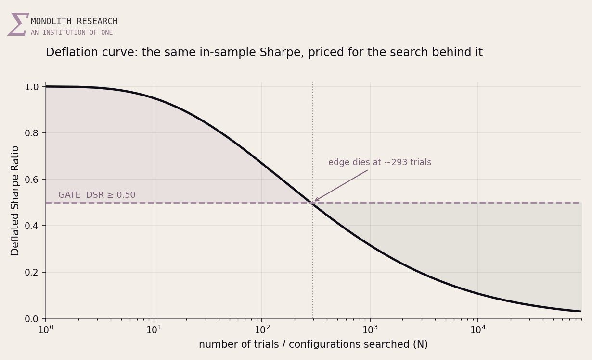
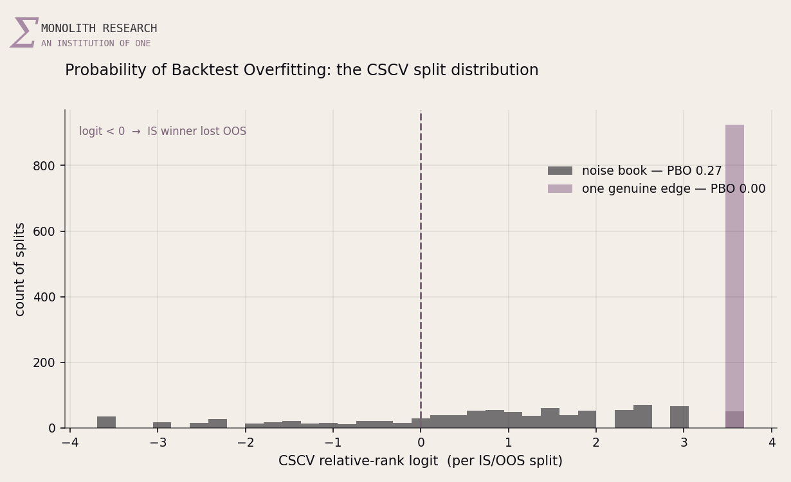

<div align="center">


# monolith-validation

**The anti-overfitting gate I built — then used to kill my own strategies.**

Σ · MONOLITH RESEARCH · *Evidence over narrative*

[](https://github.com/MonolithResearch/quant-validation/actions/workflows/ci.yml)


</div>

---

A Sharpe of 3 means nothing if you tried a thousand configs to find it — you've reported the best of a thousand coin-flips, not an edge. This is the referee I run every strategy past before I let myself believe it, and so far it has failed every single one I've shown it, including the two I had trading real money.

That isn't a flaw in the library. A research process that never says *no* is a marketing process.

## The gate

A strategy only ships if it clears all three:

```
DSR ≥ 0.50        PBO ≤ 0.20        trades ≥ 50
```

## What it computes

- **PSR** — Probabilistic Sharpe: the probability your true Sharpe beats a benchmark, corrected for skew and kurtosis.
- **DSR** — Deflated Sharpe: PSR penalised for how many trials you actually ran (explicit trial count + the Euler–Mascheroni expected-maximum). This is the line most ideas die on.
- **MinTRL** — how long a track record has to be before its Sharpe is believable.
- **PBO via CSCV** — how often your in-sample winner underperforms the median out of sample.
- Skew/kurtosis-adjusted Sharpe confidence intervals, and a cost/slippage implementation band.

Built straight from Bailey & López de Prado: PSR ([SSRN 1821643](https://papers.ssrn.com/sol3/papers.cfm?abstract_id=1821643)), Deflated Sharpe ([2460551](https://papers.ssrn.com/sol3/papers.cfm?abstract_id=2460551)), PBO/CSCV ([2326253](https://papers.ssrn.com/sol3/papers.cfm?abstract_id=2326253)).

## Install

```bash
git clone https://github.com/MonolithResearch/quant-validation.git
cd quant-validation
pip install -e ".[dev]"
```

Python ≥ 3.10, just `numpy` / `scipy` / `pandas`.

## In thirty seconds

A backtest that looks finished — until you tell the gate how many configurations you searched to get it.

```python
import numpy as np
from monolith_validation import litigious_report, DEFAULT_GATE

# ~3.5 years of daily P&L from your "best" configuration.
rng = np.random.default_rng(9)
daily_returns = rng.normal(0.0009, 0.011, size=900)

# The Sharpes of EVERY trial you ran to get here.
# This is what deflates the edge — most people quietly forget to report it.
trial_sharpes = list(rng.normal(0.9, 0.6, size=400))   # 400 configurations searched

verdict = litigious_report(
    daily_returns,
    periods_per_year=252,
    trial_sharpes=trial_sharpes,
    trade_count=140,
)

print(f"annualised Sharpe        {verdict.sharpe:.2f}")
print(f"PSR (vs 0)               {verdict.psr:.3f}")
print(f"E[max Sharpe] by luck    {verdict.expected_max_sharpe_annual:.2f}")
print(f"Deflated Sharpe (DSR)    {verdict.deflated_sharpe:.3f}   gate >= 0.50")
print(f"GATE                     {'PASS' if verdict.gate_pass else 'FAIL'}")
```

```
annualised Sharpe        1.53
PSR (vs 0)               0.998
E[max Sharpe] by luck    1.87
Deflated Sharpe (DSR)    0.262   gate >= 0.50
GATE                     FAIL
```

A 1.53 Sharpe at PSR 0.998 reads like a product. Once the gate prices in the 400 trials behind it, the expected best-by-luck Sharpe is **1.87** — higher than what was actually found — and the Deflated Sharpe collapses to **0.262**. The gate fails it. That is the entire job.

## It failed my own live books — by design

| strategy | in-sample | honest out-of-sample | verdict |
|---|---|---|---|
| **OU Top-5** (live) | PSR 0.987 | selection-DSR 0.497, PBO 0.548, 23 trades | **FAIL** |
| **Gold H4 v2** (live) | DSR 0.352 | walk-forward OOS Sharpe **−0.87** | **FAIL** |

I've since put **34** of my own strategies through this gate on blind out-of-sample DSR. **Zero passed.** Every post-mortem — order-statistic mirages, foresight that can't beat the spread, beta in an alpha costume, a signal caught by a pre-registered holdout — lives in its own repo:

→ **[strategy-graveyard](https://github.com/MonolithResearch/strategy-graveyard)**

## The two charts worth generating

```bash
pip install -e ".[plots]"
python examples/make_plots.py
```

**Deflation curve** — the same in-sample Sharpe re-priced for the trials behind it. A result that clears the gate after one trial can be dead well before a few hundred.



**Probability of Backtest Overfitting** — the CSCV split for a noise book versus one with a real signal. When the in-sample winner keeps losing out of sample, PBO climbs.



## Tests

27 known-answer tests pin each statistic to textbook values and adversarial constructions (PSR against Φ(1.96) = 0.975, the deflation benchmark against its two-trial anchor, PBO against engineered dominant and adversarial books). The gate itself is validated, not just the strategies it judges.

```bash
pytest -q     # 27 passed
```

## About

I'm **Bilal Malik** — Finance at Lancaster (first-year: First Class), top 15 of ~2,200 in the IMC Prosperity trading competition, IBT high distinction, multilingual. **Monolith Research** is my quant startup. I keep one strategy on live capital private; this library is the discipline behind it. *(A small FTMO funded account runs on the side.)*

The discipline that lets you trust a track record is the same one that makes you throw most of them away. This gate threw away all of mine that hadn't earned it.

Part of my portfolio → **[github.com/05bilalmalik-cmd](https://github.com/05bilalmalik-cmd)**

<div align="center">

Σ · **MONOLITH RESEARCH** · *Evidence over narrative*

MIT · methodology and synthetic demos only · no proprietary or licensed data

</div>
